# Temporal Shopping Workflow (Python)

A runnable shopping-order demo using Python and **open-source Temporal locally**.
An order goes through four steps:

**Receive order -> deduct payment -> check/reserve inventory -> deliver product.**

The demo shows durable execution, worker restart, two workers processing orders
in parallel, worker takeover, retryable API failures, and non-retryable invalid
payments.

Payment, inventory, and delivery are **simulated local API operations**, not HTTP
calls to real providers. SQLite stores their durable state. No real payment is
charged or product shipped, and no Temporal Cloud account is required.

## Features

- A single worker process runs both workflow orchestration and all activities.
- A second identical worker shares the task queue and can execute other orders
  or take over an interrupted activity.
- Temporary API failures retry with exponential backoff, within a **30-minute
  budget per step** by default.
- An invalid payment is non-retryable: the order fails after one payment attempt.
- Inventory or delivery failure refunds a charged payment and releases any
  reserved stock before failing the workflow.
- Idempotent operations prevent duplicate payment, stock reservation, and
  delivery when an activity executes again after a lost acknowledgement.
- Real Temporal UI screenshots below show timelines and failure/recovery results.

## How Temporal is used

Temporal's server persists workflow history, routes tasks, and manages retry
timers and timeouts. The **workers**, not the server, execute the Python code.

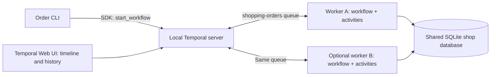

Both workers register the same workflow and activities. **An order is not pinned
to a worker**: successive tasks may run on different workers. Each worker allows
one activity at a time to make the two-worker parallelism demonstration clear.
It can still process workflow tasks while an activity is running.

| Component | Role and Temporal calls |
| --- | --- |
| [shopping/cli.py](shopping/cli.py) | `Client.connect()` and `client.start_workflow()` submit `ShoppingOrder` on `shopping-orders`. With `--wait`, `handle.result()` waits for success or raises a workflow failure. `init` and `inspect` access SQLite directly. |
| [shopping/worker.py](shopping/worker.py) | Connects to Temporal, registers `ShoppingOrder` and all five activities in one `Worker`, then polls the shared queue. `--identity` labels the worker in history and logs. |
| [shopping/workflows.py](shopping/workflows.py) | Uses `workflow.execute_activity()` to schedule the four steps and compensation. Defines retry policies, timeouts, and the failure/recovery path. |
| [shopping/activities.py](shopping/activities.py) | `@activity.defn` exposes the simulated APIs. Uses `activity.info().attempt` to simulate transient outages, sends heartbeats, and reports errors through `ApplicationError`. |
| [shopping/store.py](shopping/store.py) | Applies idempotent SQLite transactions and records each activity's worker, attempt, phase, and UTC timestamp. No Temporal calls. |
| [shopping/models.py](shopping/models.py) | Order input/result dataclasses, scenario names, validation, and the queue name. |

The server's workflow history and the shop database are **separate stores**.
The former remembers orchestration; the latter remembers external side effects.
Both must survive worker restarts.

## Workflow and failure path

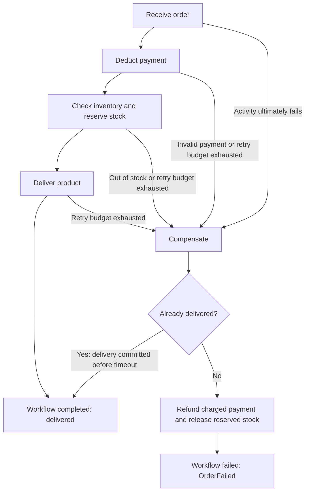

Retryable failures stay within the same activity until it succeeds or its
overall deadline expires. The failure arrows do not run after every failed
attempt. An invalid payment or other business rejection skips retries.

Compensation checks durable state first. A timeout is not proof that an API
operation did not commit. Already delivered orders are not refunded.

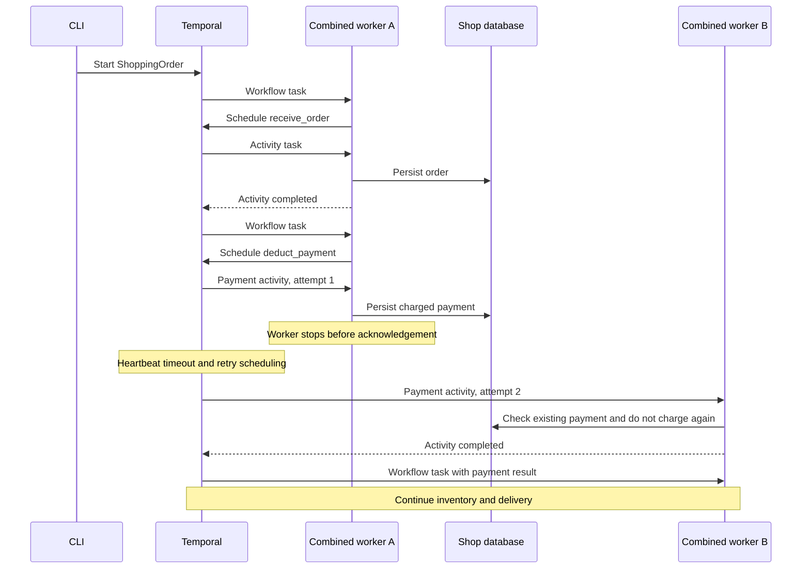

With only one worker, the retry waits until that worker restarts. With another
healthy worker on the same queue, no manual reassignment is needed. Workflow
code replays history to reconstruct progress; completed activities recorded in
history do not rerun just because of replay. Unacknowledged activities can rerun,
so side-effect idempotency remains essential.

## Where failure policies are defined

In [shopping/workflows.py](shopping/workflows.py), every normal step uses:

```python
RetryPolicy(
    initial_interval=timedelta(seconds=2),
    backoff_coefficient=2,
    maximum_interval=timedelta(seconds=30),
    maximum_attempts=0,
)
```

| Policy | Behavior |
| --- | --- |
| Overall activity deadline | `schedule_to_close_timeout=order.retry_seconds`; default 1,800 seconds (30 minutes), including queue waits, attempts, and backoff. This is per step, not a 30-minute limit for the whole order. |
| Attempts | No fixed attempt limit; retries are bounded by the overall deadline. Backoff starts at 2 seconds, doubles, and caps at 30 seconds. |
| Execution attempt timeout | Normally 20 seconds; increases for configured demonstration delays, never above the activity's overall budget. |
| Heartbeat timeout | 5 seconds. Activities heartbeat during simulated API and acknowledgement delays so a stopped worker's task can be retried. Detection and reassignment are not instantaneous. |
| Invalid payment | The activity raises `ApplicationError(..., type="ShopRejection", non_retryable=True)`. The workflow compensates, then raises non-retryable `OrderFailed`. |
| Compensation | Uses a 20-second attempt timeout and retries with no overall deadline, so it can keep the workflow running until retryable infrastructure failures recover. A terminal compensation error fails the workflow. |

`--retry-seconds` deliberately permits a shorter demonstration budget. **The
20-second exhaustion screenshot is not evidence of a real 30-minute outage run.**
The default 1,800-second policy was verified in actual Temporal history and is
visible in the policy screenshot. Tests use eight seconds for exhaustion.

## Demonstrations

To run these scenarios, complete [Setup](#setup) first.

The screenshots below are from real local executions, not mockups. Capture
versions: Temporal CLI 1.9.1, server 1.32.0, UI 2.54.1, Python SDK 1.34.0.
The screenshots retain local timestamps; store events use UTC.

### A. One worker: follow the complete timeline

```powershell
.\.venv\Scripts\python.exe -m shopping.cli order --id single-demo --step-seconds 4 --wait
```

Open the order in the UI, choose **Timeline**, and scroll below the input/result.
The four activity bars show receive, payment, inventory, and delivery.
**Event History** shows the scheduling, start, and completion events. Click a
timeline activity to inspect its policy, executing worker identity, and attempts.

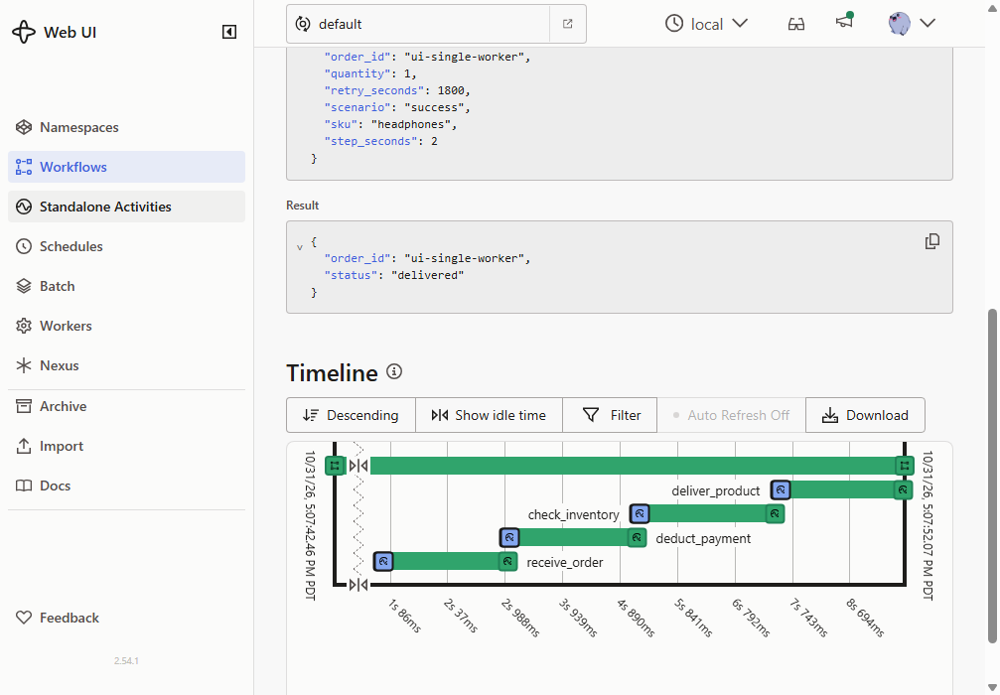

### B. Stop and restart the only worker

```powershell
.\.venv\Scripts\python.exe -m shopping.cli order `
  --id restart-demo --step-seconds 1 --acknowledgement-seconds 10
```

1. In the worker terminal, wait for `COMMITTED ... step=deduct_payment`.
2. Stop that worker with `Ctrl+C` during the acknowledgement delay. For an abrupt
   process crash, use PowerShell `Stop-Process -Id` with that worker's exact PID
   from `READY`, not a process-name-wide command.
3. Leave Temporal running. The UI keeps the order running and shows payment
   awaiting retry. No worker is available to progress it.
4. Restart `shopping.worker --identity worker-A` using the same database.
5. Refresh the **same workflow/run**, not a newly submitted order. Payment retries
   safely, then inventory and delivery finish. Receive order does not run again.

The acknowledgement delay applies to each normal step and is only a demonstration
aid. Stopping before an API commits is also recoverable; its next attempt performs
the operation normally.

The pending retry does not restart the order from the beginning.

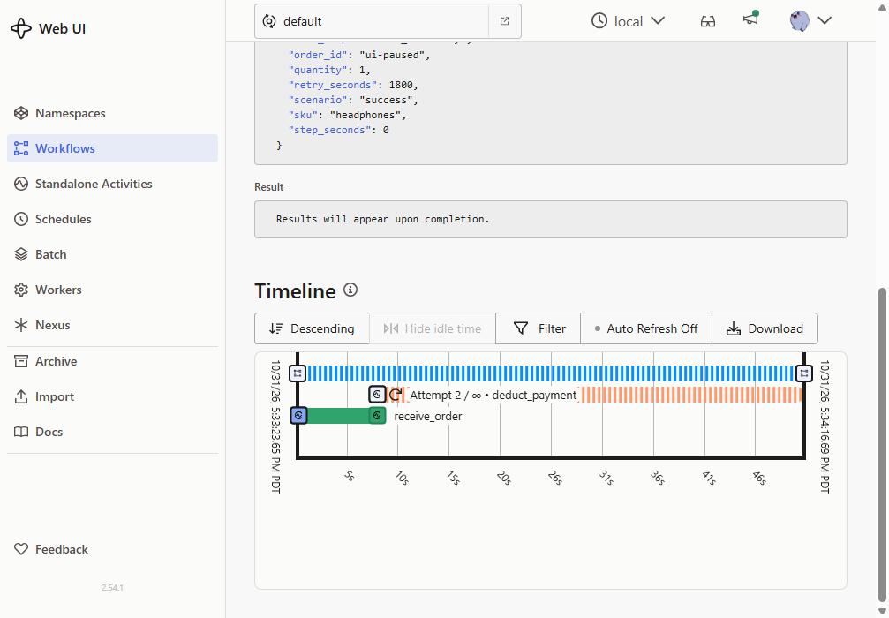

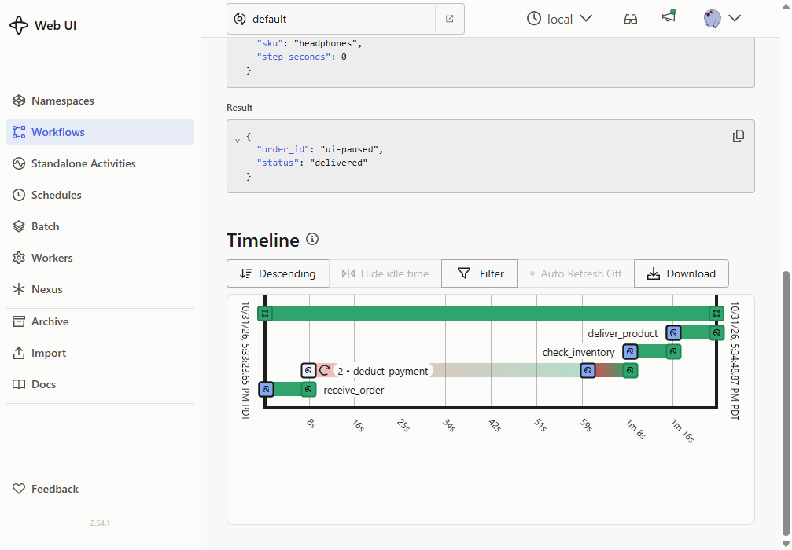

The activity detail shows the real default **30-minute Schedule To Close Timeout**.

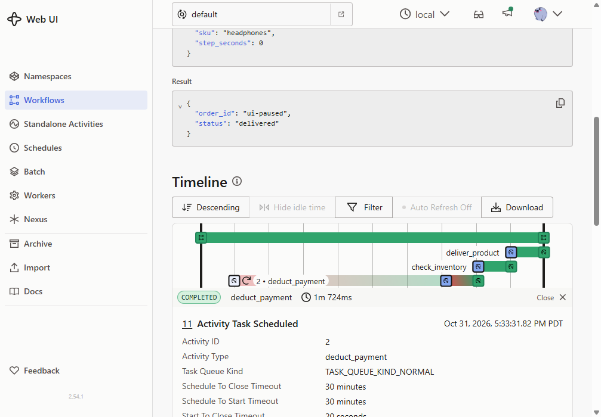

The retried payment detail shows **worker-A, attempt 2**, with a previous heartbeat
timeout and a successful `paid` result.

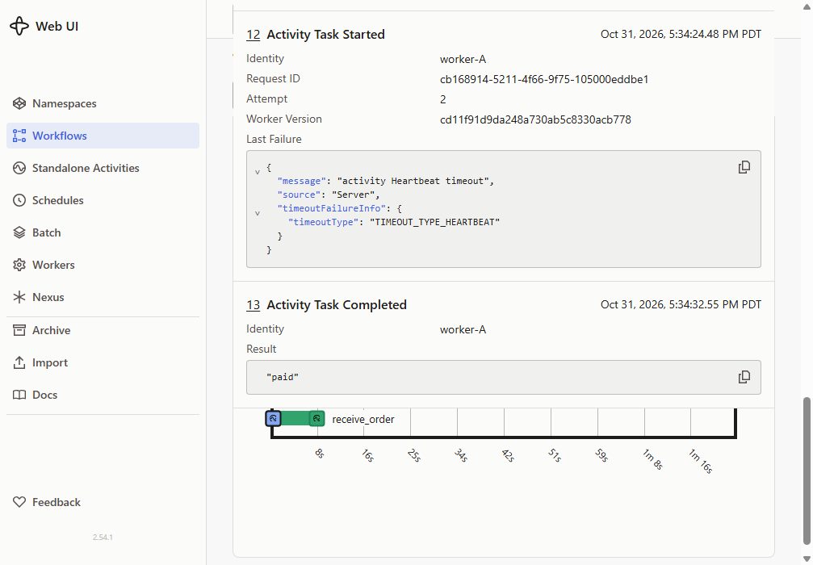

### C. Two workers, two orders in parallel

Keep A running and start B in another terminal:

```powershell
.\.venv\Scripts\python.exe -m shopping.worker --identity worker-B
```

Then submit two orders without waiting:

```powershell
.\.venv\Scripts\python.exe -m shopping.cli order --id parallel-1 --step-seconds 5
.\.venv\Scripts\python.exe -m shopping.cli order --id parallel-2 --step-seconds 5
```

The workflow list can show both running. Compare each timeline and
`shopping.cli inspect --id parallel-1` / `parallel-2`: overlapping UTC start
times and different worker identities demonstrate actual parallel activity
execution. Scheduling is not guaranteed to assign one entire order to each worker.

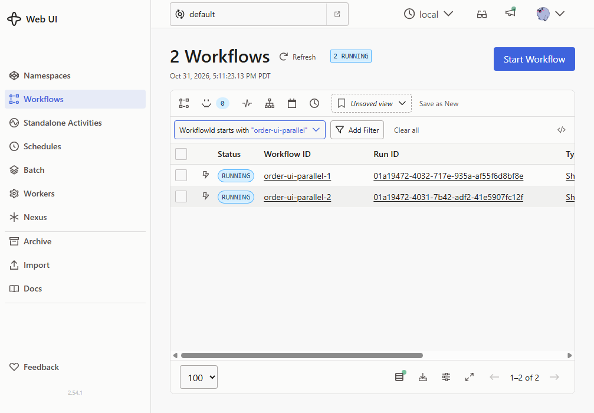

### D. One of two workers fails: the other takes over

With A and B running:

```powershell
.\.venv\Scripts\python.exe -m shopping.cli order `
  --id takeover-demo --step-seconds 1 --acknowledgement-seconds 10
```

Watch which worker logs the committed payment. Stop **that worker only**, leaving
the other worker and Temporal running. The surviving worker executes the retry
after the heartbeat timeout/backoff and finishes the order. Inspect events to
see the identity change; completed steps and committed side effects are preserved.

The takeover timeline's `2` beside payment represents the retried activity.
Store events confirm B performed attempt 1 and A performed attempt 2.

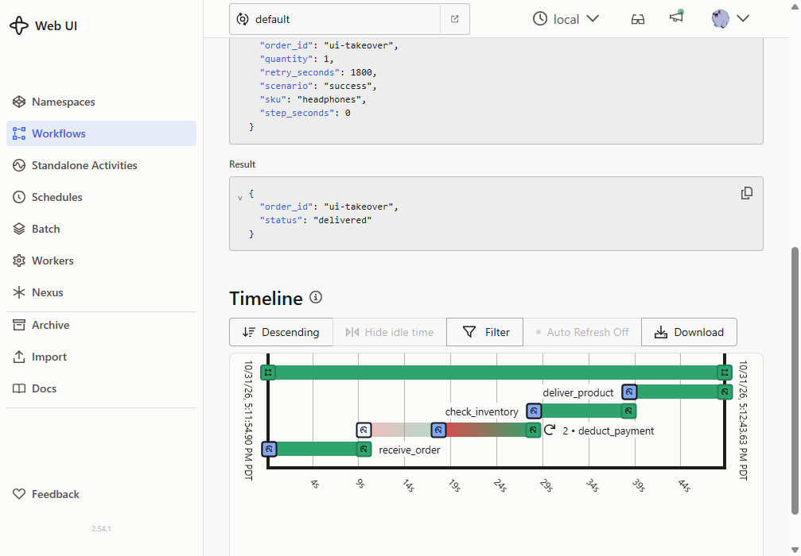

### E. API outage that recovers

```powershell
.\.venv\Scripts\python.exe -m shopping.cli order `
  --id api-recovers --scenario transient --fail-step check_inventory --wait
```

The selected API fails on attempts 1 and 2, then succeeds on attempt 3. The order
is delivered. `--fail-step` can target `deduct_payment`, `check_inventory`, or
`deliver_product`.

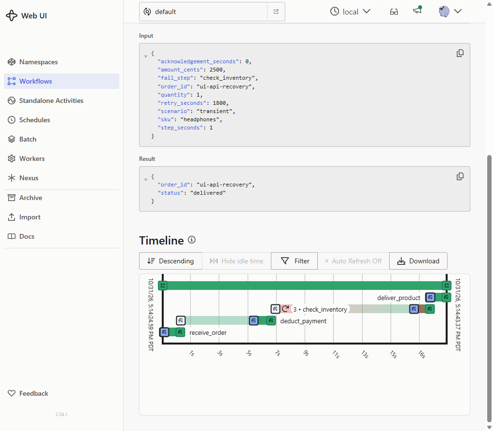

### F. API stays unavailable until the retry budget expires

Real 30-minute per-step budget:

```powershell
.\.venv\Scripts\python.exe -m shopping.cli order `
  --id long-outage --scenario api-down --fail-step deliver_product --wait
```

Shortened version used for UI evidence:

```powershell
.\.venv\Scripts\python.exe -m shopping.cli order `
  --id short-outage --scenario api-down --fail-step deliver_product `
  --retry-seconds 20 --step-seconds 1 --wait
```

After delivery's budget expires, the workflow refunds payment, releases reserved
stock, and fails. Total order duration includes earlier steps and compensation,
so it can exceed the failing activity's budget.

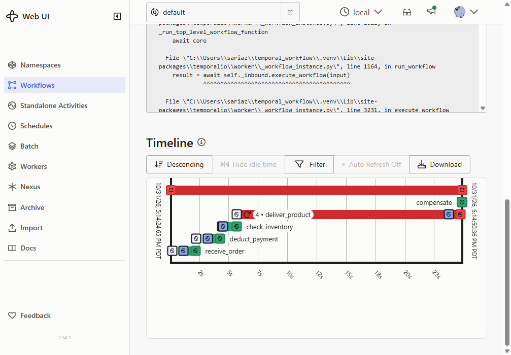

### G. Invalid payment: fail without retry

```powershell
.\.venv\Scripts\python.exe -m shopping.cli order `
  --id declined-order --scenario invalid-payment --wait
```

Payment has exactly one attempt and no charge. Inventory and delivery never run.
Compensation safely settles the received order without refunding money that was
never charged. The UI shows a failed workflow, not a success-shaped result.
`--scenario out-of-stock` similarly rejects inventory and refunds payment.

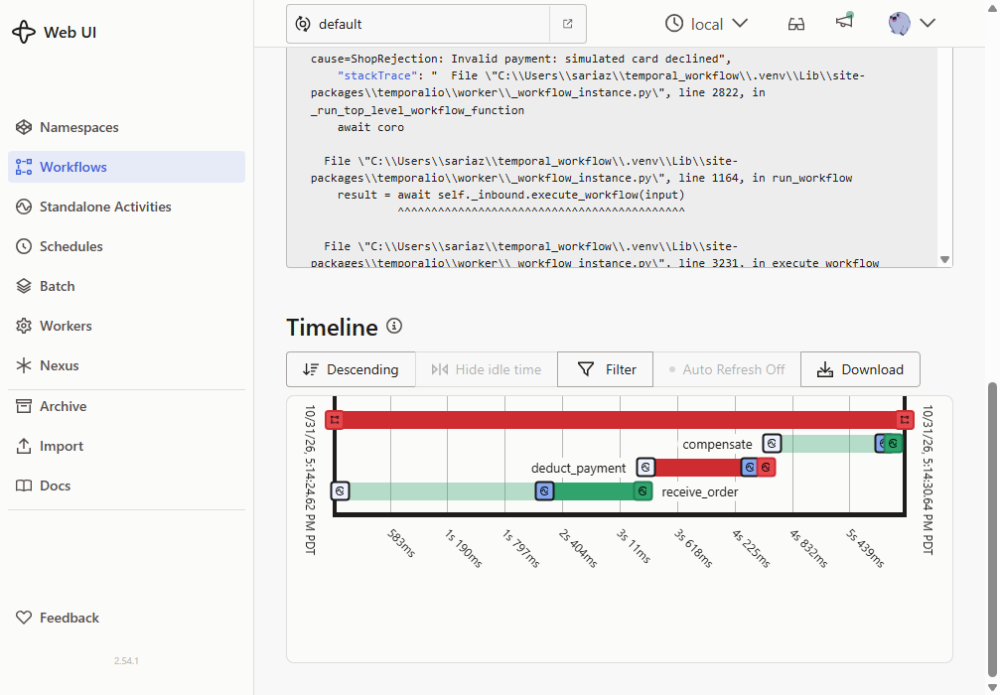

## Actual UI results

| Captured order | Observed result, verified against history/store |
| --- | --- |
| `ui-single-worker` | Delivered; all four activities executed by worker-A. |
| `ui-paused` | While A was stopped: running, charged payment, no inventory reservation. After restart: delivered in the same run; receive executed once, payment retried at attempt 2 without another charge. |
| `ui-parallel-1`, `ui-parallel-2` | Both delivered. Receive activities started at `00:11:18.094Z` on B and `00:11:18.077Z` on A, before either completed. |
| `ui-takeover` | Interrupted payment attempt 1 on B; surviving A ran attempt 2 and delivered the order. |
| `ui-api-recovery` | Inventory attempts 1 and 2 failed; attempt 3 succeeded; delivered. |
| `ui-invalid-payment` | Failed; one payment attempt; payment and inventory remained `none`. |
| `ui-api-exhausted` | **20-second delivery budget**; four delivery attempts; workflow failed with payment `refunded` and inventory `released`. |

## Setup

Prerequisites: Python 3.10+, PowerShell, and the
[Temporal CLI](https://github.com/temporalio/cli/releases).
Run commands from this project directory.

### 1. Install the Python project

```powershell
python -m venv .venv
.\.venv\Scripts\python.exe -m pip install -e .
```

For tests and linting:

```powershell
.\.venv\Scripts\python.exe -m pip install -e ".[dev]"
```

### 2. Install Temporal CLI if it is missing

If `temporal` is already on your PATH, use it instead of `.\.tools\temporal.exe`.
For Windows x64, this installs the same official version used for the screenshots:

```powershell
New-Item -ItemType Directory -Force .tools | Out-Null
Invoke-WebRequest `
  -Uri "https://github.com/temporalio/cli/releases/download/v1.9.1/temporal_cli_1.9.1_windows_amd64.zip" `
  -OutFile ".tools\temporal.zip"
Expand-Archive ".tools\temporal.zip" -DestinationPath ".tools" -Force
.\.tools\temporal.exe --version
```

For other platforms or architectures, use the matching official release.

### 3. Initialize the shop and start Temporal

```powershell
.\.venv\Scripts\python.exe -m shopping.cli init
.\.tools\temporal.exe server start-dev --db-filename data\temporal-shopping.db
```

Initialization creates the shop database and seeds 100 headphones. It does not
reset existing orders or stock. Keep this server terminal running.

| Setting | Default |
| --- | --- |
| Temporal endpoint / namespace | `localhost:7233` / `default` |
| Temporal Web UI | <http://localhost:8233> |
| Shared task queue | `shopping-orders` |
| Simulated shop database | `data/shop.db` |
| Persisted server database in these instructions | `data/temporal-shopping.db` |
| Order | One pair of headphones, payment amount 2,500 cents |

### 4. Start one combined worker in a second terminal

```powershell
.\.venv\Scripts\python.exe -m shopping.worker --identity worker-A
```

Wait for `READY`. Logs identify the worker, its process ID, order, activity step,
attempt number, and when a side effect commits.

### 5. Submit an order in a third terminal

```powershell
.\.venv\Scripts\python.exe -m shopping.cli order --id first-order --wait
.\.venv\Scripts\python.exe -m shopping.cli inspect --id first-order
```

The CLI prints a workflow ID (`order-first-order`) and run ID. Without `--wait`
it returns immediately, which is useful for submitting concurrent orders.
With `--wait`, failed orders print an error and exit with status 1.

Use a unique ID for each new run, or omit `--id` to generate a UUID. The CLI
rejects workflow ID reuse. Workers and order submissions accept `--address` and
`--task-queue`; workers and `init`/`inspect` accept `--database`. All workers
sharing a queue must use the same durable shop database.

## Tests and validation

With the demo server running:

```powershell
$env:TEMPORAL_TEST_ADDRESS = "localhost:7233"
.\.venv\Scripts\python.exe -m pytest tests -q
.\.venv\Scripts\python.exe -m ruff check shopping tests
```

Without an existing server, set `$env:TEMPORAL_CLI` to the absolute CLI executable
path and omit `TEMPORAL_TEST_ADDRESS`; the tests start/stop an isolated dev server.

- [tests/test_store.py](tests/test_store.py): idempotency, compensation fencing,
  invalid requests/payment, changed-ID rejection, and concurrent stock reservation.
- [tests/test_workflow.py](tests/test_workflow.py): real Temporal execution,
  transient retry attempt counts, 1,800-second default policy in history,
  shortened exhaustion, refunds/releases, interrupted commit takeover, and
  overlapping execution on two workers.

**Recorded validation: 22 tests passed; Ruff passed; Python syntax checks passed.**
Pylance's file checks could not resolve the newly created modules in this session,
so editor-side type validation is not claimed. Tests use unique queues and
temporary shop databases; they do not reset demonstration stock or orders.

## Limitations

- This is a simulated shop, not a production payment or fulfillment system.
  Payment is represented by durable state, and delivery by a delivered order;
  there is no external processor or carrier.
- Both workers must share this SQLite database on one machine. A distributed
  deployment needs durable shared API/database infrastructure, not independent
  local files per host.
- Temporal activities are not exactly-once. Idempotency must also be implemented
  in real payment, inventory, and delivery integrations.
- A pending task can exhaust its overall budget while no workers are available.
  Recovery is therefore bounded for normal steps, not unlimited.
- Compensation can wait indefinitely on retryable failures. Dedicated cancellation
  handling, authentication, production monitoring, and real integrations are not
  implemented.
- The dev server is not a production deployment. Preserve both databases for
  recovery.

## Resources

- [Temporal documentation](https://docs.temporal.io/)
- [Python SDK documentation](https://docs.temporal.io/develop/python)
- [Python SDK API reference](https://python.temporal.io/)
- [Official Python samples](https://github.com/temporalio/samples-python)
