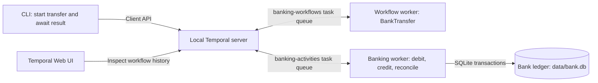
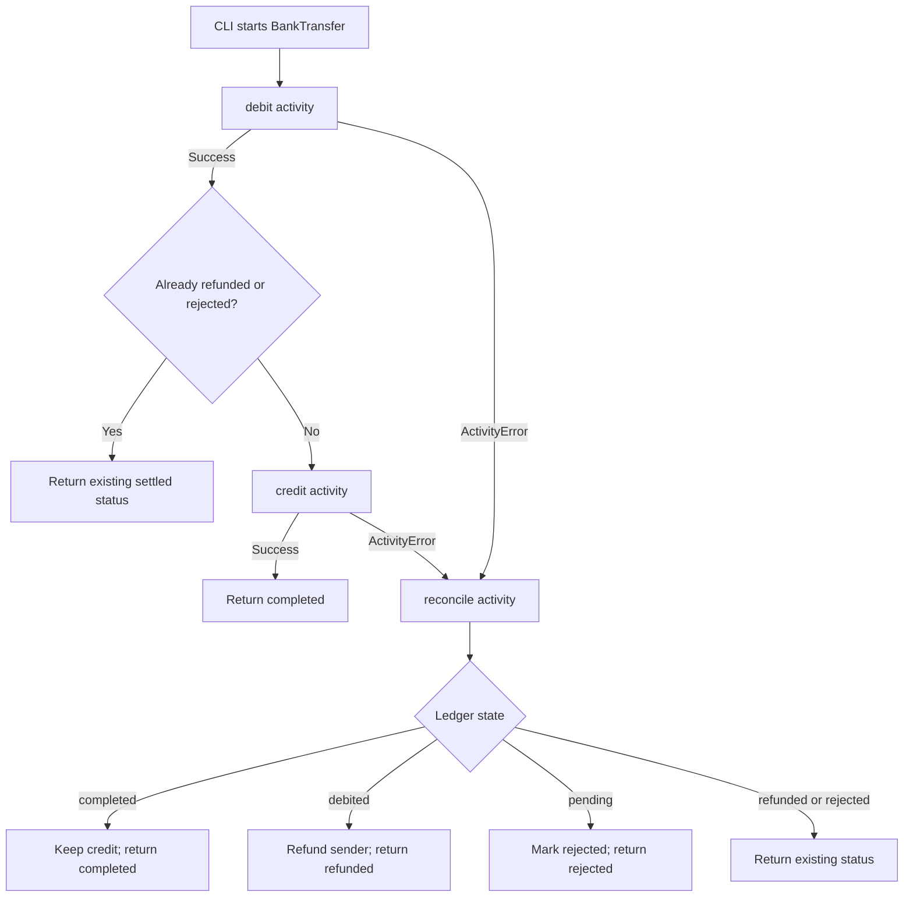
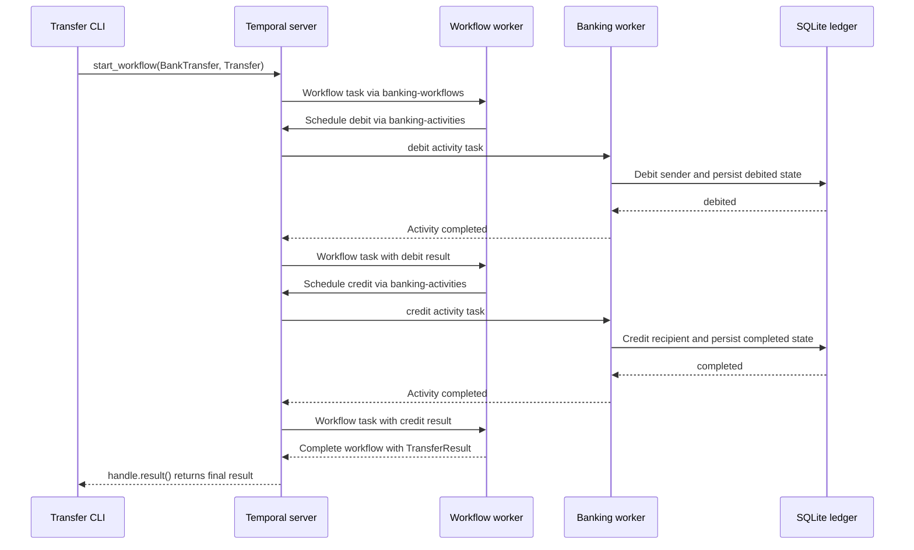

# Temporal Banking Workflow (Python)

A local, simulated bank-transfer demo built with Python and
[open-source Temporal](https://temporal.io/). It shows how to coordinate a
multi-step operation when a bank is temporarily unavailable, rejects a transfer,
or a worker stops after committing a transaction.

The feature is a transfer from one account to another: **debit the sender, credit
the recipient, and reconcile the ledger if an operation fails**. Temporal manages
the orchestration, retries, and execution history; SQLite simulates the bank.
No real money moves, no external banking API is called, and no Temporal Cloud
account or subscription is required.

## Features

- Transfer integer amounts in cents between the demo accounts `alice` and `bob`.
  Each account starts with 10,000 cents when a new ledger is initialized.
- Retry temporary bank outages with exponential backoff.
- Refund a debit when the destination bank permanently rejects the credit.
- Recover from a banking worker stopping after credit commits but before Temporal
  receives its completion.
- Use transfer IDs and transactional ledger state to make repeated operations
  idempotent rather than debit or credit twice.
- Run orchestration and banking activities in separate worker processes.
- Inspect workflow history in Temporal's Web UI and balances through the CLI.

## Why Temporal is used

A regular script can lose track of a transfer if it stops between debit and
credit. This project makes the transfer a **durable workflow**. Temporal records
workflow history, schedules tasks, and manages activity retry timers. The Python
workers execute the actual application code.

Workflow code is deterministic orchestration: it decides which activity to run
next and how to react to failure. Activities perform side effects, including
SQLite transactions. A restarted workflow worker can reconstruct workflow
progress by replaying history; completed activities recorded in history are not
rerun just because the workflow is replayed.

An activity can still execute more than once if its result is not acknowledged.
Temporal does **not** make external side effects exactly-once. The ledger's
idempotency checks handle that case.

## Architecture and worker responsibilities



Workers poll Temporal for tasks; they do not call each other directly. A task
queue is a routing name, not a separate server or a Python thread. All clients and
workers use the same Temporal server and namespace.

| Component | Responsibility | How it uses Temporal |
| --- | --- | --- |
| Transfer CLI in [banking/cli.py](banking/cli.py) | Builds a `Transfer`, starts it, and prints the final result. | `Client.connect()` connects to the server. `client.start_workflow()` starts `BankTransfer.run` on `banking-workflows`; `handle.result()` waits for completion. |
| Workflow worker in [banking/worker.py](banking/worker.py) | Runs durable orchestration, not database operations. | `Worker(..., workflows=[BankTransfer])` polls `banking-workflows`. The workflow uses `workflow.execute_activity()` to schedule banking tasks. |
| Banking worker in [banking/worker.py](banking/worker.py) | Executes bank operations and initializes the ledger if needed. | `Worker(..., activities=[...])` polls `banking-activities`, executes registered activities, and reports their results or failures through the SDK. |
| Activities in [banking/activities.py](banking/activities.py) | Run `debit`, `credit`, and `reconcile`; simulate failures. | `@activity.defn` registers operations. `activity.info().attempt` identifies retry attempts; `ApplicationError` distinguishes retryable outages from non-retryable business rejections. |
| Ledger in [banking/ledger.py](banking/ledger.py) | Validates requests and changes balances and transfer state atomically. | No Temporal calls. Synchronous SQLite operations run through a thread pool in the banking worker. |
| Local Temporal server | Stores workflow history, routes tasks, and manages retries and timeouts. | Runs separately with `temporal server start-dev`; it does not execute the Python bank code. |

The CLI's `init` and `balances` commands access SQLite directly and do not call
Temporal. The thread pool has four threads for ledger operations; it is not an
additional Temporal worker.

## Transfer workflow

The workflow is defined in [banking/workflows.py](banking/workflows.py).



The failure arrows apply when Temporal reports an activity failure, for example
after retries are exhausted, a timeout expires, or a non-retryable rejection
occurs. Reconciliation first checks the ledger: a timeout does not prove that a
bank transaction failed to commit.

### Calls for a successful transfer



### Retry and timeout settings

- **Debit and credit:** up to four attempts each, including the first attempt.
  Retry intervals start at one second, double, and are capped at four seconds.
- **Per-attempt timeout:** 30 seconds (`start_to_close_timeout`).
- **Overall debit/credit timeout:** five minutes per activity
  (`schedule_to_close_timeout`), including queue waits and retries.
- **Business rejection:** a `BankError` becomes a non-retryable `BankRejection`
  and triggers reconciliation without retrying that rejected operation.
- **Reconciliation:** 30 seconds per attempt, with retry intervals capped at ten
  seconds. No maximum attempt count or overall timeout is configured, so retryable
  reconciliation failures can keep the workflow running. A non-retryable error
  in reconciliation fails the workflow rather than returning a settled result.

### Ledger states and idempotency

Normal state progression is `pending -> debited -> completed`. Compensation
changes `debited -> refunded`; reconciliation before a debit commits changes
`pending -> rejected`. Completed, refunded, and rejected transfers stay settled.

Each ledger transaction updates balances and transfer state together. Repeated
calls check that state and do not repeat a completed money movement. A transfer
ID cannot be reused with different request details.

The CLI gives the workflow the ID `transfer-<transfer_id>` and sets
`WorkflowIDReusePolicy.REJECT_DUPLICATE`. Use a new transfer ID for each new demo
run; omitting `--id` generates a UUID.

## Setup and running the demo

Prerequisites: Python 3.10 or newer, the
[Temporal CLI](https://docs.temporal.io/cli), and PowerShell.
Run all Python commands below from this project directory. The explicit virtual
environment interpreter avoids PowerShell activation-policy issues.

### 1. Install the project

```powershell
python -m venv .venv
.\.venv\Scripts\python.exe -m pip install -e .
```

Dependencies are declared in [pyproject.toml](pyproject.toml), including
`temporalio>=1.9,<2`.

### 2. Start Temporal in a separate terminal

```powershell
temporal server start-dev --db-filename temporal-dev.db
```

The database flag preserves local workflow history across server restarts.
Without it, `temporal server start-dev` runs an in-memory development server.
Temporal's database is separate from the bank ledger.

| Setting | Default |
| --- | --- |
| Temporal server | `localhost:7233` |
| Temporal Web UI | <http://localhost:8233> |
| Namespace | `default` |
| Workflow task queue | `banking-workflows` |
| Activity task queue | `banking-activities` |
| Bank ledger | `data/bank.db` |

### 3. Initialize the bank ledger

```powershell
.\.venv\Scripts\python.exe -m banking.cli init
```

Initialization creates missing tables and accounts; it does not reset existing
balances or transfers.

### 4. Start both workers in separate terminals

Workflow worker:

```powershell
.\.venv\Scripts\python.exe -m banking.worker workflow
```

Banking activity worker:

```powershell
.\.venv\Scripts\python.exe -m banking.worker banking
```

Keep the Temporal server and both workers running.

### 5. Start a transfer and inspect the result

```powershell
.\.venv\Scripts\python.exe -m banking.cli transfer --scenario success --amount-cents 1000
.\.venv\Scripts\python.exe -m banking.cli balances
```

On a freshly initialized ledger, this moves 1,000 cents from Alice to Bob:
Alice has 9,000 cents and Bob has 11,000 cents. The transfer command prints the
workflow ID, waits for completion, then prints JSON with `transfer_id`, `status`,
and `detail`. Open the Web UI to inspect the execution.

The transfer CLI and both workers accept `--address` for a different Temporal
endpoint. The banking worker and the `init`/`balances` commands accept
`--database`; use the same ledger path for all banking operations.

## Failure scenarios to try

| Scenario | What happens | Expected result with valid accounts and sufficient funds |
| --- | --- | --- |
| `success` | Debit and credit succeed. | `completed` |
| `transient` | Credit attempts 1 and 2 simulate a bank outage before changing the ledger. Temporal retries; attempt 3 credits the recipient. | `completed` |
| `permanent` | The destination bank rejects credit after debit. The rejection is non-retryable; reconciliation refunds the sender. | `refunded` |
| `crash-credit` | Credit commits on attempt 1, then delays its acknowledgement for 20 seconds so you can stop the banking worker. | `completed` after recovery, without a duplicate credit |

```powershell
.\.venv\Scripts\python.exe -m banking.cli transfer --scenario transient
.\.venv\Scripts\python.exe -m banking.cli transfer --scenario permanent
.\.venv\Scripts\python.exe -m banking.cli transfer --scenario crash-credit
```

For the crash demo, watch the banking worker for **CREDIT COMMITTED**. Stop only
that worker with `Ctrl+C` during the 20-second delay, then restart it using the
same database path. Keep the server and workflow worker running. If completion
was not acknowledged, the activity can be retried after its attempt times out;
the ledger returns `completed` without crediting Bob again. If you do not stop
the worker, the activity simply completes after the delay.

Scenario runs share the ledger, so successful runs accumulate balance changes.
These expected results assume reconciliation can access the ledger and does not
itself encounter a terminal error.

## Project files

| File | Contents |
| --- | --- |
| [banking/models.py](banking/models.py) | Transfer input/result dataclasses, scenarios, and task queue names. |
| [banking/workflows.py](banking/workflows.py) | `BankTransfer` orchestration, retry policies, and compensation path. |
| [banking/activities.py](banking/activities.py) | Temporal activity definitions and simulated outages/crash window. |
| [banking/ledger.py](banking/ledger.py) | SQLite accounts, transfer state, validation, and idempotent transactions. |
| [banking/worker.py](banking/worker.py) | Entrypoint for either the workflow worker or banking activity worker. |
| [banking/cli.py](banking/cli.py) | Initialize the ledger, view balances, or start and await a transfer. |
| [pyproject.toml](pyproject.toml) | Package metadata, dependencies, and development-tool configuration. |

## Scope and limitations

This is a learning demo, not a production banking system. It uses one local
SQLite ledger, not transactions across independent real banks. It does not
implement authentication, real bank integrations, or dedicated workflow
cancellation handling. Automated tests have not been added yet.

The local Temporal development server is not a production deployment. Durable
recovery depends on preserving both Temporal history and the banking database.
Keep database I/O in activities and maintain ledger idempotency when extending
the demo; retries alone are not sufficient to prevent duplicate side effects.

## Resources

- [Temporal documentation](https://docs.temporal.io/)
- [Python SDK documentation](https://docs.temporal.io/develop/python)
- [Python SDK API reference](https://python.temporal.io/)
- [Official Python samples](https://github.com/temporalio/samples-python)
